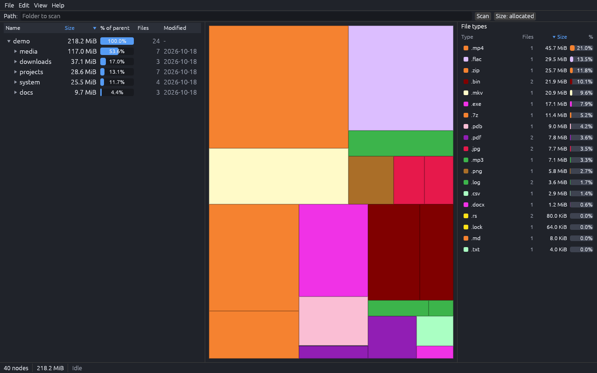

# diRUSTat

**diRUSTat** = **Dir** + **Rust** + **Stat**: directory statistics, written in Rust (and a nod to WinDirStat).

A fast disk-space analyzer in pure Rust: "where did my space go?" in the style of WinDirStat, at WizTree speed.

> Status: **M1 and M2 done, M3 (NTFS MFT fast path) code-complete.** Working desktop app (egui/eframe on wgpu): directory tree, treemap, file-type list, scan, logical/allocated size modes, command palette, JSON control channel, CLI and MCP server. Remaining for M3: the 1M-file MFT measurement outlier. Next: M4 (delete to recycle bin, reveal in file manager, cleanups, search, filters). A QA pass found 23 bugs, 20 of them are fixed. Details: [ROADMAP.md](ROADMAP.md), [plan/STATUS.md](plan/STATUS.md).



## Goals

- **Feature parity with WinDirStat:** directory tree, treemap with cushion shading, file-type list with colours, cleanups, search, filters.
- **WizTree-class speed:** direct NTFS MFT reading (fast path, Windows) and a parallel portable walk for other filesystems.
- **Native, no shells:** egui/eframe on wgpu. No Tauri/Electron/webview, no JS/TS.
- **Every feature available to agents:** all actions are commands; JSON control channel, CLI and MCP server.
- **Never crashes:** no `unwrap`/`panic`/`unsafe` (except the isolated MFT crate); hostile input yields errors.
- **Data safety:** scanning is read-only; deletion goes through the recycle bin and requires confirmation.

## Quick start

```sh
cargo run --release -p dirustat -- --demo   # desktop app on synthetic demo data
cargo run -p dirustat-cli             # headless CLI
cargo xtask ci                        # full quality gate
```

Requires stable Rust (see `rust-toolchain.toml`). Details: [docs/development.md](docs/development.md).

## For agents and contributors

Start with [AGENTS.md](AGENTS.md) (Claude Code reads `CLAUDE.md`, which imports `AGENTS.md`), then `plan/STATUS.md`. Architecture: [docs/architecture.md](docs/architecture.md); rules: [docs/contributing.md](docs/contributing.md).

## License

MIT OR Apache-2.0 ([LICENSE-MIT](LICENSE-MIT), [LICENSE-APACHE](LICENSE-APACHE)). WinDirStat and WizTree are trademarks of their owners; this project is unaffiliated and implemented clean-room ([docs/clean-room.md](docs/clean-room.md)).
